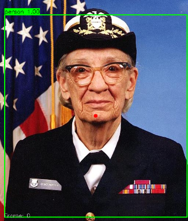

# Video Safety Monitor — person detection and keep-out zone alerts on video


A small video safety monitor. It finds people in video with a pretrained
Faster R-CNN (a two-stage object detector). It flags anyone whose box centre
enters a keep-out zone and logs every event with a timestamp. It uses plain
OpenCV and torchvision, no detection framework. 20 tests, CI on Python 3.12
and 3.13.



*Real model output on the public-domain Grace Hopper portrait bundled with
matplotlib. Box, centre point and `person 1.00` label come from the model;
nothing is hand-placed.*

## Result

Measured locally on CPU (Apple Silicon, macOS). Small-scale numbers, not
benchmark targets.

- Real detection: 1 person, score `0.999`, on the photo above (Faster R-CNN, ResNet-50 FPN backbone, CPU).
- Motion + logging path (`--no-detect`, 160×120 synthetic clip): ~270 FPS. The non-detection path is effectively free.
- Detection path: one 640×480 forward pass takes ~4 s/frame (≈0.2–0.3 FPS) on this CPU. So the detector runs every *N* frames and boxes are reused in between.
- A synthetic blank frame yields zero person detections, as expected.

Research link: a safety monitor is only as reliable as its perception stage.
This repo measures that stage's latency budget, keeps a fallback mode
(`--no-detect`), and writes a timestamped event log. That log is the kind of
telemetry my fault-diagnosis and failure-prediction work consumes. The repo
itself does not do fault diagnosis.

## How it works

```
        video / webcam
              │
              ▼
      ┌──────────────┐     every Nth frame      ┌─────────────────────────┐
      │   capture    │ ───────────────────────▶ │ Faster R-CNN (person)   │
      │ (read_video) │                          │  model_loader.detect()  │
      └──────┬───────┘                          └───────────┬─────────────┘
             │ frame                                         │ boxes + scores
             │                                               ▼
             │                                    ┌────────────────────┐
             │                                    │ ROI rule engine    │  roi_guard
             │                                    │ (centre-in-zone)   │
             │                                    └─────────┬──────────┘
             ▼                                              │ intrusions
      ┌──────────────┐   motion mask + ratio                ▼
      │ MOG2 motion  │ ──────────────────────────▶ ┌────────────────────┐
      │  detector    │                             │  event logger      │  event_logger
      └──────┬───────┘                             │  (timestamped CSV) │
             │                                     └────────────────────┘
             ▼
      ┌──────────────────────────────────┐
      │ annotate (draw_shapes) +         │
      │ VideoWriter → result.mp4         │
      └──────────────────────────────────┘
```

- Preprocessing: resize, crop that never leaves the frame, and resize + pad to a square (letterbox).
- Detection: BGR frame → RGB tensor → Faster R-CNN → keep COCO dataset class `person` above a score threshold.
- Rule layer: is the box centre inside the zone? Motion = share of changed pixels (MOG2, a background-subtraction model). Events go to a CSV with UTC timestamps.
- Pipeline (`04_pipeline/run_pipeline.py`): detect every *N* frames, reuse boxes in between, draw the overlay, write an annotated video.

## Run it

```bash
# run from the repository root
python3 -m venv .venv
source .venv/bin/activate          # Windows: .venv\Scripts\activate
pip install -r requirements.txt
python 04_pipeline/run_pipeline.py --source clip.mp4 --roi 200 150 450 380   # downloads ~160 MB of weights on first run
python 04_pipeline/run_pipeline.py --source clip.mp4 --no-detect             # motion only, no torch
pip install -r requirements-dev.txt && pytest                                 # tests
```

Outputs (frames, annotated video, `events.csv`) go to `data/output/`, which is
git-ignored.

## Limitations

- Pretrained, inference-only, and single-class (person) today.
- The detector is slow on CPU (~4 s/frame at 640×480). A real deployment wants a GPU or a lighter backbone.
- The throughput numbers above have no saved log or benchmark script in the repo yet.
- Not implemented: lighter backbone (`fasterrcnn_mobilenet_v3_large_fpn`), polygonal ROIs, per-track dwell-time rules, CPU-vs-GPU FPS table.

## More

- [Details](docs/DETAILS.md): features, tech stack, layout, module notes, tests, throughput notes, synthetic demo image, design notes, roadmap.
- Pinned dependencies: [`requirements.txt`](requirements.txt) (runtime), [`requirements-dev.txt`](requirements-dev.txt) (tests + lint).

## License

Released under the [MIT License](LICENSE).

— Jun Hur · [portfolio](https://hurjun.github.io) · [KCC 2024 paper](https://hurjun.github.io/asset/kcc2024-kiise-nursing-record-paper.pdf) · hurjun96@gmail.com
